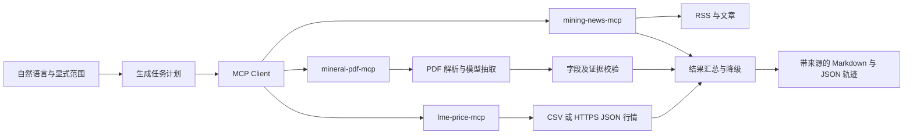

# 架构与取舍

系统为第 2 题提供三个独立 MCP Server 和一个确定性规划 Agent。默认无需模型即可验证协议及交付流程；真实 PDF 抽取才调用模型。无微服务集群、向量库或额外数据库，控制 24 小时作业的实现和运行成本。

## MCP 是实际边界

客户端启动三个独立子进程，逐个 initialize 与 list_tools，核对必须工具，再使用 call_tool 获取结果。未在计划中声明的工具不允许调用。新闻搜索和两种价格请求并发执行；文章最多获取 3 篇；资源 PDF 最多处理 1 份。

默认约 6 次工具调用，不进行无限 ReAct 循环。外部文本不会成为新的工具计划，因此新闻中的“忽略上文”类内容不会触发额外文件访问或调用。所有 MCP 协议输出走 stdout；SDK 日志走 stderr。

## 为什么选择固定状态机

题目工作流范围明确，新闻、资源、价格三个域已知。使用确定性计划更容易复现、限定请求量和验证缺失行为；仍可组合真实 MCP 工具。项目没有把固定模板包装成自主推理模型。新闻摘要是可核验摘录，报告渲染不再调用模型生成无来源的数字。

模型适配器采用 JSON Chat 接口，模型 ID、基地址与 Key 可配置。实现会验证 JSON 对象及 Pydantic schema，对超时、429 和部分 5xx 进行有限重试。服务端响应正文、请求头和 Key 不写日志。接口使用 `messages` 与 `response_format={type: json_object}`；模型／网关必须支持这一契约。参考 [Chat Completions API](https://platform.openai.com/docs/api-reference/chat/create)。本环境未进行真实模型端到端调用，不能把 mock 测试理解为提供商可用性证明。

## 边界与降级

| 问题 | 行为 |
|---|---|
| 新闻源不可达 | 保留来源失败；已有其他 Feed 的结果仍可展示 |
| 正文不可提取 | 展示带标签的 RSS 摘要 |
| 缺失 PDF | 资源部分标注缺失 |
| 模型缺 Key、失败或 JSON 不合法 | 资源不可用，不猜数值 |
| 页码、引用、分类、单位不一致 | 候选资源不进入日报 |
| PDF 项目不符／日期晚于日报 | 日报隐藏该资源记录 |
| 当日行情缺失 | 不用前一交易日冒充当日价格 |
| 走势合约不一致 | 不计算混合趋势 |
| MCP 服务启动失败 | 整次任务失败并暴露启动错误，避免生成伪完整报告 |
| 单次工具失败 | 记录 error 并继续其他部分 |

## PDF 范围

读取包含 Indicated/Inferred 的全部文本页及相邻页。扫描文件需先在外部完成 OCR；候选页没有找到或超过上下文预算时停止，避免静默截断。JSON 中保留实际选中页码。当前不是多模态表格系统，没有跨页布局的完整保证。

题目对 NI 43-101 的要求由 schema 与抽取提示保留；Pilbara 示例实际可能采用 JORC，因此显式支持并标注 JORC。不会把矿业资源分类转换成另一报告标准，也不推断法律意义上的采矿权。

## 网络与数据防护

外部抓取仅允许公开 HTTPS；拒绝 URL 用户名密码、非标准端口及解析到私网／loopback／reserved 的地址，每次跳转重新检查。限制跳转次数、文件大小和请求超时。此为开发作业级防护；生产部署还应加出口网络策略与地址绑定来防御 DNS 重绑定，不将应用内 DNS 预检查描述为完整隔离。

模型凭据只传给 PDF 子进程，新闻和价格进程不接收。日志和 JSON 轨迹可能包含下载的公开文档内容，真实运行输出默认 Git 忽略。

## 可扩展点

优先扩展真实授权价格适配器、已核验的报告目录及 OCR；再根据实际使用量添加缓存与持久化。复杂自然语言规划可以接在 BriefPlan 之前，但必须继续通过结构校验与工具白名单，不能让生成文本直接变成任意调用。
